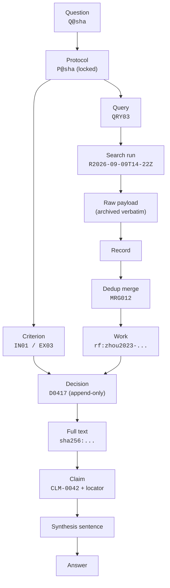

# The Traceability Chain

The product of the Research Factory is not the wiki. It is the **unbroken chain from any
sentence in a conclusion back to the protocol decision that admitted the evidence.**
Everything else — adapters, wiki views, synthesis — is scaffolding around that chain.

A literature survey is scientific when a stranger can reconstruct how you got there and
get the same result. That requires three properties, none of which come free:

1. **Traceable** — every claim resolves backwards to a locator in a source document, and
   forwards from a protocol decision. No orphans in either direction.
2. **Reproducible** — the deterministic stages re-run to the same corpus, or report
   exactly what changed and why.
3. **Auditable** — every judgment is recorded with its criterion, its rationale, its
   timestamp, and its author (agent or human). Judgments are never silently revised.

## The chain



Twelve links. Every one is a file on disk with a stable ID. Two commands exercise it:

```
rf trace CLM-0042        # backwards: claim -> ... -> the question that authorized it
rf trace --forward Q@a1b # forwards: everything this question version produced
```

`rf check` fails the build if any link is broken: a claim with no locator, a work with no
provenance, an exclusion with no criterion ID, a synthesis sentence with no claim.

## What each link must carry

| Link | Must record | Governing standard |
| --- | --- | --- |
| Question | text, framing, version hash, supersedes | PRISMA-P item 1–4 |
| Protocol | criteria with IDs, sources, limits, freeze timestamp | PRISMA-P (17 items), PROSPERO |
| Query | exact string, source, platform/interface, filters, date | **PRISMA-S** |
| Search run | n_returned, raw payload archived verbatim, tool version | PRISMA-S |
| Dedup merge | matched-on rule, records absorbed, reversible map | PRISMA 2020 flow |
| Decision | stage, verdict, criterion ID, rationale, reviewer, timestamp | Cochrane MECIR |
| Full text | source URL/file, sha256, extraction method, quality | PRISMA-S |
| Appraisal | instrument + item-level answers, not just a grade | RoB 2 / ROBINS-I / GRADE / AACODS |
| Claim | statement, work ID, **locator**, evidence type, strength | — |
| Synthesis | claim IDs behind every sentence | PRISMA 2020 item 20–22 |

The standards are not decoration. They are the reason the output is defensible, and they
tell us exactly which fields are non-optional. **PRISMA-S** in particular is the one most
often skipped and the one that makes a search actually re-runnable.

## The three mechanisms that make it hold

### 1. Append-only decisions

A decision is never edited. A changed mind writes a new decision that `supersedes` the
old one, with a reason. The log is the evidence that screening was not tuned until it
agreed with the conclusion.

```yaml
- id: D0417
  work: rf:zhou2023-coronary-ssl
  stage: title-abstract
  verdict: exclude
  criteria: [EX02]
  rationale: "Phantom data only; EX02 requires in-vivo acquisition."
  reviewer: agent:screen-titles@v1
  at: 2026-09-09T15:02Z
- id: D0631
  supersedes: D0417
  verdict: include
  rationale: "§2.1 reports an in-vivo validation cohort missed on abstract-only read."
  reviewer: human:aserban
  at: 2026-09-11T09:40Z
```

### 2. Dual review and inter-rater agreement

Single-reviewer screening is not accepted practice, and an agent is a single reviewer with
a confident voice. The factory screens **twice, independently** — two passes that cannot
see each other's verdicts — and computes **Cohen's κ**.

- Disagreements are never auto-resolved. They route to you.
- κ below a protocol-declared floor (default 0.7) **fails the screening gate**: the
  criteria are ambiguous, not the reviewers.
- A human-labelled calibration set of ~30 records is scored before each run, so drift is
  measured rather than assumed.

This is the mechanism that turns "an LLM read the abstracts" into a defensible method,
and it is the piece most agentic review tools omit.

### 3. Replay

Deterministic stages are re-runnable: `rf replay --from 03` re-executes searches against
the archived queries and **diffs against the recorded corpus**. Sources change under you —
records are retracted, indexed late, re-classified. Replay makes that visible instead of
silent, and the diff itself is an artifact.

## Consequence for the design

Two revisions to `DESIGN.md`:

- **Provenance is not a field, it is the schema.** A `Work` that cannot name the run,
  query and raw payload that produced it is invalid at construction, not at lint time.
- **Appraisal stores item-level answers**, not a summary grade. "Moderate certainty" is
  not traceable; the five GRADE domains with reasons are.
